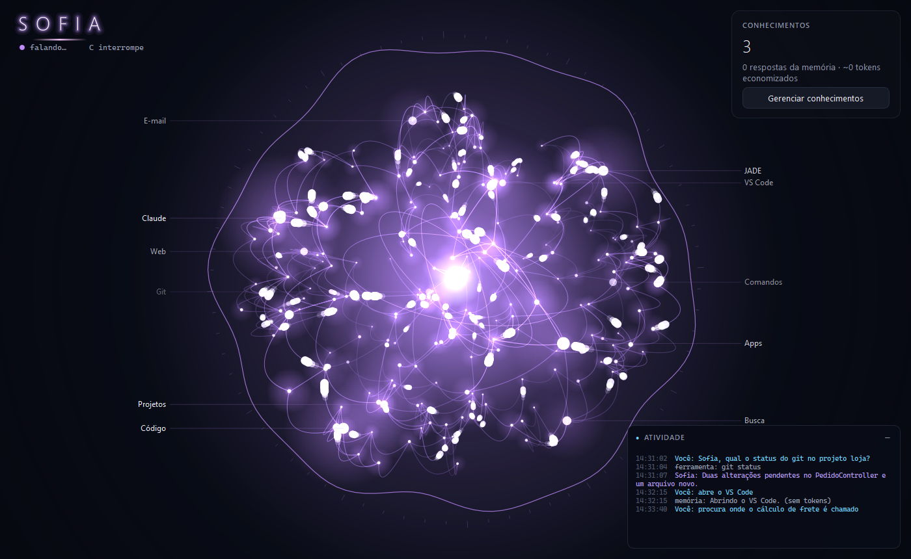

# Sofia — download

A **Sofia** é uma assistente de voz para Windows. Você diz "Sofia" e ela consulta seus projetos de código, abre sites e aplicativos, conversa com o VS Code e o Claude Code e aprende com o que você pede, para responder de novo sem gastar tokens.

Este repositório guarda só os instaladores. Site: **https://sofia-chi-eight.vercel.app**

## Baixar

**[Baixar a versão mais recente (Sofia-Setup.exe)](https://github.com/FeSilva/sofia-download/releases/latest/download/Sofia-Setup.exe)**

Versões anteriores e o que mudou em cada uma: [Releases](https://github.com/FeSilva/sofia-download/releases).

## Instalar

1. Abra o `Sofia-Setup.exe`. Ele instala só para o seu usuário, sem pedir administrador, e cria o atalho no Menu Iniciar.
2. Se o Windows mostrar "O Windows protegeu o computador", clique em **Mais informações** → **Executar assim mesmo**.
3. Abra a Sofia e entre com a conta de **administrador geral da sua organização na JADE**.
4. Na primeira vez ela baixa o modelo de voz (cerca de 500 MB). A rede fica azul até terminar.

## Requisitos

| | |
|---|---|
| Sistema | Windows 10 ou 11, 64 bits |
| Instalador | cerca de 150 MB |
| Microfone | qualquer um |
| Conta | administrador geral de uma organização na JADE |
| Placa NVIDIA | opcional, deixa a escuta mais rápida |

## Atualizações

Depois do login, a Sofia confere se há versão nova. Se houver, ela mostra as novidades e oferece **Atualizar agora**: baixa o instalador, instala por cima e abre de novo. Suas configurações e o que ela aprendeu continuam no lugar.

Algumas atualizações são obrigatórias (por exemplo, correções de segurança). Nesse caso, a Sofia só volta a funcionar depois de atualizar.

## Privacidade

- A transcrição da sua voz é feita no seu computador. O áudio não sai da máquina.
- Ela só acessa as pastas de projeto que você liberar, e arquivos com segredos ficam bloqueados.
- Criar ou editar arquivos e rodar comandos sempre pede sua confirmação por voz.

## Desinstalar

Configurações do Windows → **Aplicativos** → **Sofia** → **Desinstalar**. Os seus dados ficam em `%USERPROFILE%\.assistente-voz`; apague essa pasta se quiser removê-los também.
